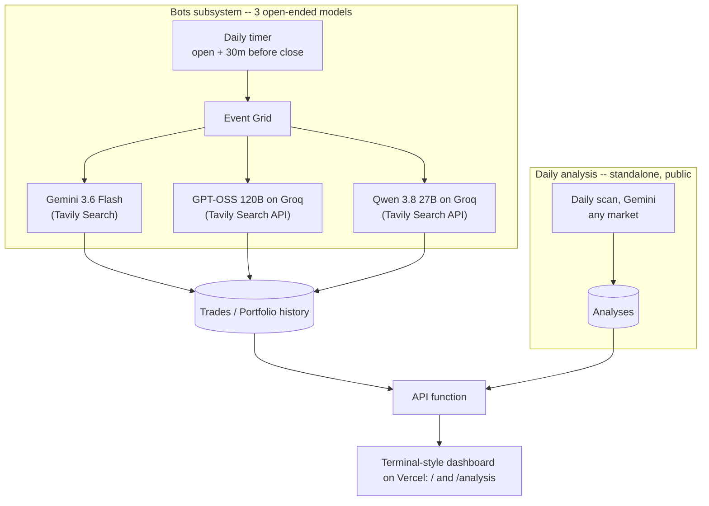

# AI trading bot sandbox (on Azure)

**The goal of this project is to experiment with AI capabilities in the stock market, the repository will continuously evolve as trading strategies, market analysis and AI integrations are refined.**

Two loosely-coupled AI jobs, built on Azure's Always Free tier, using Terraform:

1. **The bots** — three independent traders running the same open-ended prompt on three different models: `gemini-3.6-flash` (Google, with Tavily web search), `openai/gpt-oss-120b` on Groq (with Tavily web search tool calling), and `qwen/qwen3.8-27b` on Groq (with Tavily web search tool calling). The bots decide their positions at market open and 30 minutes before market close. They can take **long, short, or flat positions** and choose a **leverage multiplier from 1.0x (spot) to 10.0x (margin)**.
2. **The daily analysis** — a standalone, public-facing analysis that scans broadly (any market) for situations where the market's reaction to news is disproportionate, identifying **asymmetries**. It generates both a 1-2 sentence executive thesis and a detailed, multi-paragraph Markdown investment report (~150-250 words) per setup.

---


## How it fits together




---


## What's in this repo

```
terraform/     -- everything above, as one Terraform config
functions/
  daily-timer/     -- fires at open + 30m before close; the Event Grid publisher
  analysis-report/ -- daily scan + asymmetries (thesis & detailed markdown reports)
  bot/             -- portfolio-level agent, researches and chooses its own symbols, style, and leverage
  api/             -- leaderboard, trades, portfolio history, daily analysis, Web PubSub negotiate
frontend/      -- Next.js/TypeScript terminal-style dashboard (reference copy; the live deployment lives in a separate repo and may be ahead of what's here)
```

---


## The LLM providers and strategy rules

- **Google Gemini** — powers `open_gemini` (`gemini-3.6-flash`) with native Gemini function-calling for live Tavily web search, and also powers the daily analysis scan.
- **OpenAI GPT-OSS** — powers `open_gptoss` (`openai/gpt-oss-120b` on Groq), dynamically performing live web research via Tavily's AI search API.
- **Alibaba Qwen** — powers `open_qwen` (`qwen/qwen3.8-27b` on Groq), dynamically performing live web research via Tavily's AI search API.
- **Position Decisions, Multi-Market Coverage & Leverage**:
  - Each bot makes one portfolio-level decision per review. It can autonomously select assets across **US Equities & ETFs** (`NVDA`, `SPY`, etc.), **Brazilian B3 Equities** (`PETR4.SA`, `VALE3.SA`, etc.), **Cryptocurrencies in USD** (`BTC/USD`, `ETH/USD`, `SOL/USD`), and **Global Equities / Forex** (`EURUSD=X`, `GBPUSD=X`).
  - The LLM outputs an `"type"` field per decision (`"stock"`, `"etf"`, `"crypto"`, `"forex"`, `"brazil"`) which is used to route the ticker to the correct price feed without guessing, preventing cross-market ticker collisions (e.g. NIO the stock vs NIO the crypto token).
  - Powered by a unified, free multi-market data engine querying **Finnhub** (US), **Coinbase & Binance public APIs** (Crypto 24/7), and **Yahoo Finance chart API** (B3 & Global).
  - Every open position is live-priced before the prompt. The model receives its complete holdings, cash balance, mark prices, and total net liquidation value.
  - Bots choose a leverage multiplier from **1.0 (spot) up to 10.0 (leveraged margin)**.
  - Sizing is calculated dynamically based on total net portfolio value with fractional support for crypto.
- **The strategy stance**:
  - The bots are open-ended. They can decide whether momentum, mean reversion, catalyst trading, valuation, or simply staying out is the right choice on a given day.
  - **Holding is implicit** — if the LLM omits a ticker from its output, the position is kept as-is. Duplicate decisions that target the same notional exposure as the current position (within 2%) are silently discarded to prevent accidental rebalancing from LLM math hallucinations.

---


## Reliability & Resilience

- **Exponential backoff**: All LLM API calls retry up to 6 times with exponential backoff (5s → 10s → 20s → 40s → 60s cap), recovering gracefully from transient 429 and 503 rate-limit spikes.
- **Robust JSON parsing**: If an LLM outputs conversational text before or around its JSON decision, the backend strips the preamble and extracts the JSON array automatically.
- **Timer catch-up disabled**: `useMonitor: false` is set on all timer triggers to prevent Azure from firing catch-up runs after a deploy or restart outside market hours.
- **Legacy position recovery**: Positions saved before the `shares` field was introduced are automatically backfilled from `notional / entryPrice` at load time.

---


## Always Free — the complete resource-by-resource audit


| Resource                                  | Always Free? | Why                                                        |
| ----------------------------------------- | ------------ | ---------------------------------------------------------- |
| Resource Group                            | Yes          | No charge for the construct itself                         |
| Functions (all 5 apps)                    | Yes          | 1M requests/month + 400,000 GB-s/month, standing grant     |
| Event Grid topic + subscriptions          | Yes          | 100,000 operations/month; we use roughly 200/month         |
| Cosmos DB (all 3 containers)              | Yes          | 1,000 RU/s + 25GB, one free account per subscription       |
| Web PubSub                                | Yes          | `Free_F1` is a genuine standing SKU, not a 12-month trial  |
| Log Analytics + App Insights              | Mostly       | 5GB ingestion/month free, then ~$2.30/GB                   |
| Storage Account (Functions backing store) | No           | Pay-as-you-go from request one (a few cents/month at most) |


---


## Technical Design Details

- **Timing and drift**: Timer triggers run in UTC. Standard/Daylight saving transitions shift the actual ET market bell times by an hour; reviews run at 9:30am ET (13:30 UTC) and 3:30pm ET (19:30 UTC, 30 minutes before close).
- **Execution quote boundary**: A bot may research any asset, but a trade only proceeds when its final symbol resolves to a usable live quote. This prevents paper trades from being recorded at invented or stale prices.
- **Asset type routing**: Each LLM decision includes a `"type"` field. The backend uses it to route directly to the correct price feed (Finnhub for stocks/ETFs, Coinbase/Binance for crypto, Yahoo Finance for forex and B3) without heuristic guessing.
- **Open CORS**: The Azure API allows wide-open origins (`*`) by default, allowing simple routing from dynamic Vercel deployments.

---

## Local Backtesting & Simulation

You can test and backtest the bots and analysis function locally without deploying to Azure or requiring Cosmos DB / Web PubSub connections.

API keys are automatically discovered from `terraform/terraform.tfvars`, `functions/bot/local.settings.json`, or environment variables.

### 1. Test a single bot
```bash
# Run open_gemini for 4 sessions (2 trading days)
python scripts/backtest.py --bot open_gemini --sessions 4

# Run open_gptoss (Groq + Tavily) and resume from previous state
python scripts/backtest.py --bot open_gptoss --sessions 6 --resume

# Run open_qwen with verbose prompt/response logs
python scripts/backtest.py --bot open_qwen --sessions 2 -v
```

### 2. Multi-Bot Competition
Run all 3 bots side-by-side across N sessions and print a unified leaderboard:
```bash
python scripts/backtest.py --bot all --sessions 4
```

### 3. Test Daily Market Analysis Report
Generate and validate the Daily Market Analysis & Trade Ideas report locally:
```bash
python scripts/backtest.py --test-analysis
```

Portfolio state and trade logs are automatically saved to `scripts/backtest_state/`.

