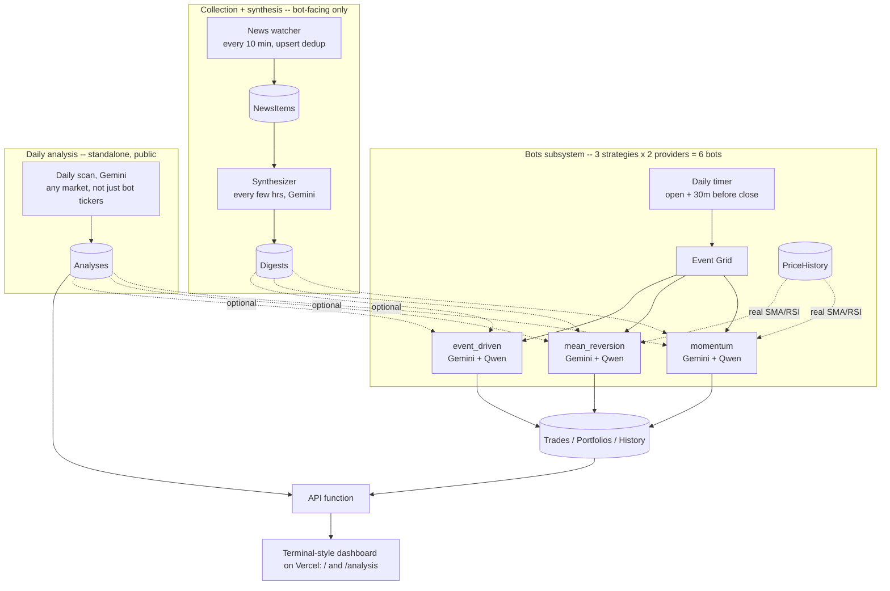

# AI trading bot sandbox (on Azure)

Three loosely-coupled AI jobs, built on Azure's Always Free tier, using Terraform:

1. **The bots** — six independent traders running three strategy families (momentum, mean-reversion, event-driven), each run once on Gemini and once on Qwen. The bots decide their positions at market open and 30 minutes before market close. They can take **long, short, or flat positions** and choose a **leverage multiplier from 1.0x (spot) to 3.0x (margin)**.
2. **Synthesis** — a bot-facing-only helper that turns raw collected news into a plain daily digest per ticker. Never shown publicly; its only job is prepping better context than raw headlines.
3. **The daily analysis** — a standalone, public-facing analysis that scans broadly (any market) for situations where the market's reaction to news is disproportionate, identifying **asymmetries**. It generates both a 1-2 sentence executive thesis and a detailed, multi-paragraph Markdown investment report (~150-250 words) per setup.

---


## How it fits together




---


## What's in this repo

```
terraform/     -- everything above, as one Terraform config
functions/
  daily-timer/     -- fires at open + 30m before close; the Event Grid publisher
  news-watcher/    -- pure collection, writes NewsItems, natural-key upsert dedup
  synthesizer/     -- bot-facing only: plain per-ticker digests, Gemini
  analysis-report/ -- daily scan + asymmetries (thesis & detailed markdown reports)
  bot/             -- decides position (long/short/flat) and leverage (1x-3x)
  api/             -- leaderboard, trades, portfolio history, daily analysis, Web PubSub negotiate
scripts/       -- price history backfill script
frontend/      -- Next.js/TypeScript terminal-style dashboard (deploys to Vercel)
```

---


## The LLM providers and strategy rules

- **Gemini** — powers the synthesizer, daily analysis, and three of the trading bots.
- **Groq (Qwen)** — powers the other three trading bots.
- **Position Decisions & Leverage**:
  - The bots evaluate context and decide to be **long** (buy/hold), **short** (sell short), or **flat** (no position).
  - They choose a leverage multiplier from **1.0 (spot) up to 3.0 (leveraged margin)**.
  - Sizing is calculated dynamically based on total net portfolio value: target shares are `(net_value * leverage) / price` for longs and `-(net_value * leverage) / price` for shorts.
  - Cash balances can become negative (borrowed margin) and holdings can be negative (short interest).
- **The three strategy families**:
  - *Momentum / trend-following* — evaluates whether the current price is above or below a real 10-day SMA.
  - *Mean-reversion* — calculates a real 7-period RSI, using classic 30/70 thresholds.
  - *Event-driven / catalyst* — depends entirely on news digests and daily market analyses.

---


## Always Free — the complete resource-by-resource audit


| Resource                                  | Always Free? | Why                                                        |
| ----------------------------------------- | ------------ | ---------------------------------------------------------- |
| Resource Group                            | Yes          | No charge for the construct itself                         |
| Functions (all 6 apps)                    | Yes          | 1M requests/month + 400,000 GB-s/month, standing grant     |
| Event Grid topic + subscriptions          | Yes          | 100,000 operations/month; we use roughly 200/month         |
| Cosmos DB (all 6 containers)              | Yes          | 1,000 RU/s + 25GB, one free account per subscription       |
| Web PubSub                                | Yes          | `Free_F1` is a genuine standing SKU, not a 12-month trial  |
| Log Analytics + App Insights              | Mostly       | 5GB ingestion/month free, then ~$2.30/GB                   |
| Storage Account (Functions backing store) | No           | Pay-as-you-go from request one (a few cents/month at most) |


---


## Technical Design Details

- **News dedup is a natural-key upsert**: Finnhub's numeric article ID maps directly to the Cosmos document ID, making duplicate checks O(1) without requiring search indices.
- **Timing and drift**: Timer triggers run in UTC. Standard/Daylight saving transitions shift the actual ET market bell times by an hour; reviews run at 9:30am ET (13:30 UTC) and 3:30pm ET (19:30 UTC, 30 minutes before close).
- **Best-effort grounding**: Many assets flagged in the broad daily scan (crypto, forex, international listings) do not resolve on Finnhub's free quote tier; the generation task identifies when grounding failed instead of guessing prices.
- **Open CORS**: The Azure API allows wide-open origins (`*`) by default, allowing simple routing from dynamic Vercel deployments.

